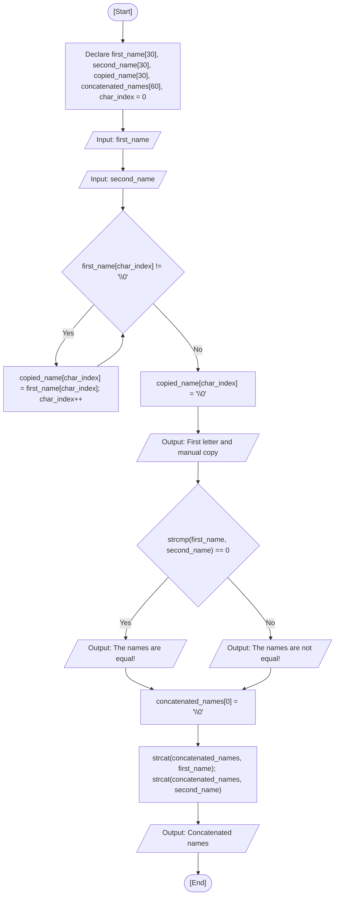

<div align="center">

  🇧🇷 **[Versão em Português](README.pt-BR.md)**
  <br>

  # ⚙️ String Manipulation (`string_manipulation.c`)

</div>

---

## 🎯 Problem Statement

Explore the representation and lifecycle of strings in standard C as null-terminated (`\0`) character arrays. In this exercise, I read two strings from the user with standard `scanf("%s")`, inspect individual characters by array indexing, perform a manual character-by-character copy ending with an explicit null terminator, compare the strings lexicographically using `strcmp`, and concatenate them into a destination buffer using `strcat` after initializing it safely.

---

## 💻 Source Code

The full implementation is available directly in [`string_manipulation.c`](string_manipulation.c).

---

## 📊 Algorithmic Flow & Trace



RAM memory trace for inputs `first_name = "Ana"` and `second_name = "Bia"`:

| Step | Instruction | `char_index` | `first_name` | `second_name` | `copied_name` | `concatenated_names` | Condition Evaluated | Terminal Output |
| :---: | :--- | :---: | :---: | :---: | :---: | :---: | :---: | :--- |
| 1 | Declaration & init | `0` | `?` | `?` | `?` | `?` | - | - |
| 2 | Read `first_name` | `0` | `"Ana\0"` | `?` | `?` | `?` | - | Prompt user |
| 3 | Read `second_name` | `0` | `"Ana\0"` | `"Bia\0"` | `?` | `?` | - | Prompt user |
| 4 | Copy loop (`char_index = 0`) | `0` | `"Ana\0"` | `"Bia\0"` | `'A'` | `?` | `first_name[0] != '\0'` -> True | - |
| 5 | Copy loop (`char_index = 1`) | `1` | `"Ana\0"` | `"Bia\0"` | `"An"` | `?` | `first_name[1] != '\0'` -> True | - |
| 6 | Copy loop (`char_index = 2`) | `2` | `"Ana\0"` | `"Bia\0"` | `"Ana"` | `?` | `first_name[2] != '\0'` -> True | - |
| 7 | Copy loop exit (`char_index = 3`) | `3` | `"Ana\0"` | `"Bia\0"` | `"Ana"` | `?` | `first_name[3] == '\0'` -> False | - |
| 8 | Null terminator assignment | `3` | `"Ana\0"` | `"Bia\0"` | `"Ana\0"` | `?` | - | - |
| 9 | First char & copy output | `3` | `"Ana\0"` | `"Bia\0"` | `"Ana\0"` | `?` | - | Display `'A'` and `"Ana"` |
| 10 | Compare strings | `3` | `"Ana\0"` | `"Bia\0"` | `"Ana\0"` | `?` | `strcmp(...) == 0` -> False | `"The names are not equal!"` |
| 11 | Initialize `concatenated_names[0]` | `3` | `"Ana\0"` | `"Bia\0"` | `"Ana\0"` | `"\0"` | - | - |
| 12 | `strcat` sequence | `3` | `"Ana\0"` | `"Bia\0"` | `"Ana\0"` | `"AnaBia\0"` | - | - |
| 13 | Output concatenated | `3` | `"Ana\0"` | `"Bia\0"` | `"Ana\0"` | `"AnaBia\0"` | - | `"Concatenated names: AnaBia"` |

---

## 🖥️ Terminal Output

```text
Insert one name: Lucas
Insert another name: Resende

First letter of 1st name: L
Manual copy of 1st name: Lucas
The names are not equal!
Concatenated names: LucasResende
```

```text
Insert one name: Fatec
Insert another name: Fatec

First letter of 1st name: F
Manual copy of 1st name: Fatec
The names are equal!
Concatenated names: FatecFatec
```

---

## 💡 Key Concepts Applied

- **Null Terminator (`\0`):** In C, strings are arrays of `char` terminated by `\0` (ASCII 0). Functions like `printf("%s")` sequentially read memory until this sentinel byte is reached.
- **Array Decaying in `scanf`:** When passing a string name to `scanf("%s", first_name)`, the identifier evaluates directly to the memory address of its first element (`&first_name[0]`), so the `&` operator is not needed.
- **Manual Copy vs. `strcpy`:** Strings cannot be assigned directly with `=`. In a manual copy, looping until `\0` followed by setting `copied_name[char_index] = '\0'` is required to prevent uninitialized memory artifacts.
- **Lexicographical Comparison (`strcmp`):** Using `first_name == second_name` compares memory addresses rather than the text content. `strcmp` inspects ASCII codes character-by-character and returns `0` when contents match.
- **Safe Concatenation (`strcat`):** `strcat` scans for the first `\0` in the destination array to start appending. Explicitly setting `concatenated_names[0] = '\0'` guarantees an empty string start before concatenating.

---

## 🚀 How to Run

```bash
# Compile and run with GCC
mkdir -p dist && gcc -Wall -O2 src/10-string-manipulation/string_manipulation.c -o dist/string_manipulation && ./dist/string_manipulation

# Or compile and run with Clang (macOS default)
mkdir -p dist && clang -Wall -O2 src/10-string-manipulation/string_manipulation.c -o dist/string_manipulation && ./dist/string_manipulation
```
