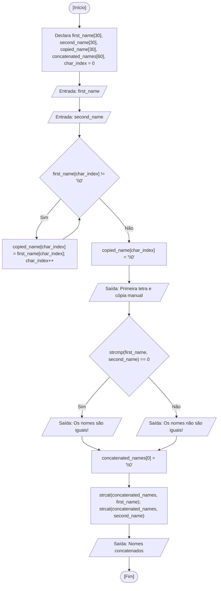

<div align="center">

  🇺🇸 **[English Version](README.md)**
  <br>

  # ⚙️ Manipulação de Strings (`string_manipulation.c`)

</div>

---

## 🎯 Enunciado do Problema

Explorar a representação e o ciclo de vida de strings no padrão C como vetores de caracteres terminados em caractere nulo (`\0`). Neste exercício, leio duas strings fornecidas pelo usuário com o `scanf("%s")` padrão de aula, inspeciono caracteres individuais por meio de índices, realizo uma cópia manual caractere por caractere finalizada com o terminador nulo explícito, comparo as cadeias de texto lexicograficamente com `strcmp` e realizo a concatenação em um terceiro vetor com `strcat` após sua inicialização segura.

---

## 💻 Código-Fonte

A implementação completa está disponível diretamente em [`string_manipulation.c`](string_manipulation.c).

---

## 📊 Fluxo e Teste de Mesa



Teste de mesa na memória RAM para as entradas `first_name = "Ana"` e `second_name = "Bia"`:

| Passo | Instrução | `char_index` | `first_name` | `second_name` | `copied_name` | `concatenated_names` | Condição Avaliada | Saída no Terminal |
| :---: | :--- | :---: | :---: | :---: | :---: | :---: | :---: | :--- |
| 1 | Declaração e inicialização | `0` | `?` | `?` | `?` | `?` | - | - |
| 2 | Leitura `first_name` | `0` | `"Ana\0"` | `?` | `?` | `?` | - | Solicita ao usuário |
| 3 | Leitura `second_name` | `0` | `"Ana\0"` | `"Bia\0"` | `?` | `?` | - | Solicita ao usuário |
| 4 | Loop de cópia (`char_index = 0`) | `0` | `"Ana\0"` | `"Bia\0"` | `'A'` | `?` | `first_name[0] != '\0'` -> Verdadeiro | - |
| 5 | Loop de cópia (`char_index = 1`) | `1` | `"Ana\0"` | `"Bia\0"` | `"An"` | `?` | `first_name[1] != '\0'` -> Verdadeiro | - |
| 6 | Loop de cópia (`char_index = 2`) | `2` | `"Ana\0"` | `"Bia\0"` | `"Ana"` | `?` | `first_name[2] != '\0'` -> Verdadeiro | - |
| 7 | Saída do loop (`char_index = 3`) | `3` | `"Ana\0"` | `"Bia\0"` | `"Ana"` | `?` | `first_name[3] == '\0'` -> Falso | - |
| 8 | Inserção do terminador nulo | `3` | `"Ana\0"` | `"Bia\0"` | `"Ana\0"` | `?` | - | - |
| 9 | Exibição 1ª letra e cópia | `3` | `"Ana\0"` | `"Bia\0"` | `"Ana\0"` | `?` | - | Exibe `'A'` e `"Ana"` |
| 10 | Comparação com `strcmp` | `3` | `"Ana\0"` | `"Bia\0"` | `"Ana\0"` | `?` | `strcmp(...) == 0` -> Falso | `"The names are not equal!"` |
| 11 | Inicialização `concatenated_names[0]` | `3` | `"Ana\0"` | `"Bia\0"` | `"Ana\0"` | `"\0"` | - | - |
| 12 | Concatenações com `strcat` | `3` | `"Ana\0"` | `"Bia\0"` | `"Ana\0"` | `"AnaBia\0"` | - | - |
| 13 | Exibição concatenada | `3` | `"Ana\0"` | `"Bia\0"` | `"Ana\0"` | `"AnaBia\0"` | - | `"Concatenated names: AnaBia"` |

---

## 🖥️ Saída no Terminal

```text
Insert one name: Lucas
Insert another name: Resende

First letter of 1st name: L
Manual copy of 1st name: Lucas
The names are not equal!
Concatenated names: LucasResende
```

```text
Insert one name: Fatec
Insert another name: Fatec

First letter of 1st name: F
Manual copy of 1st name: Fatec
The names are equal!
Concatenated names: FatecFatec
```

---

## 💡 Principais Conceitos Aplicados

- **Terminador Nulo (`\0`):** Em C, strings não são tipos primitivos, mas arrays de `char` delimitados por `\0` (ASCII 0). Funções como `printf("%s")` percorrem a memória sequencialmente até encontrar este byte sentinela.
- **Decaimento de Array no `scanf`:** Ao passar o identificador de um array para `scanf("%s", first_name)`, o compilador avalia o nome diretamente como o endereço de memória do primeiro elemento (`&first_name[0]`), tornando o operador `&` redundante.
- **Cópia Manual vs. `strcpy`:** Vetores em C não podem ser atribuídos diretamente com `=`. Na cópia manual elemento por elemento, a inclusão de `copied_name[char_index] = '\0'` ao final do laço é indispensável para evitar que lixo residual de memória seja exibido.
- **Comparação Lexicográfica com `strcmp`:** Comparar strings com o operador relacional `==` compara apenas os endereços de memória dos dois vetores. A função `strcmp` compara o conteúdo caractere por caractere na tabela ASCII, retornando `0` quando idênticos.
- **Concatenação Segura com `strcat`:** A função `strcat` busca o primeiro `\0` no array de destino para iniciar o anexo. Inicializar `concatenated_names[0] = '\0'` garante que o vetor inicie vazio em vez de herdar dados residuais da pilha.

---

## 🚀 Como Executar

```bash
# Compilar e executar com GCC
mkdir -p dist && gcc -Wall -O2 src/10-string-manipulation/string_manipulation.c -o dist/string_manipulation && ./dist/string_manipulation

# Ou compilar e executar com Clang (padrão no macOS)
mkdir -p dist && clang -Wall -O2 src/10-string-manipulation/string_manipulation.c -o dist/string_manipulation && ./dist/string_manipulation
```
