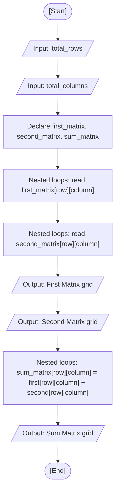

<div align="center">

  🇧🇷 **[Versão em Português](README.pt-BR.md)**
  <br>

  # ⚙️ Matrix Addition (`matrix_addition.c`)

</div>

> **Origin:** Class 09 (Strings, string.h Library & Matrices)  
> **Topic:** Two-Dimensional Arrays (2D Matrices), Nested Loops & Grid Traversals

---

## 🎯 Problem Statement

Read the dimensions (row and column count) for two integer matrices of equal size, prompt the user to input the elements for each matrix, display both matrices formatted as visual grids, and calculate their element-by-element sum into a third matrix. In my implementation, I store the values in two-dimensional variable-length arrays and traverse the cells using nested `for` loops indexed by `row` and `column`.

---

## 💻 Source Code

The full implementation is available directly in [`matrix_addition.c`](matrix_addition.c).

---

## 📊 Algorithmic Flow & Trace



RAM memory trace for a $2 \times 2$ matrix configuration:

| Step | Instruction | `row` | `column` | `first_matrix[row][column]` | `second_matrix[row][column]` | `sum_matrix[row][column]` | Terminal Output |
| :---: | :--- | :---: | :---: | :---: | :---: | :---: | :--- |
| 1 | Dimensions input | - | - | `total_rows = 2` | `total_columns = 2` | - | Prompt user |
| 2 | Read `first_matrix` | - | - | `[[1, 2], [3, 4]]` | `?` | `?` | Prompts `[row][column]` |
| 3 | Read `second_matrix` | - | - | `[[1, 2], [3, 4]]` | `[[5, 6], [7, 8]]` | `?` | Prompts `[row][column]` |
| 4 | Print input grids | - | - | Formatted output | Formatted output | `?` | Displays both 2x2 grids |
| 5 | Addition cell `[0][0]` | `0` | `0` | `1` | `5` | `1 + 5 = 6` | - |
| 6 | Addition cell `[0][1]` | `0` | `1` | `2` | `6` | `2 + 6 = 8` | - |
| 7 | Addition cell `[1][0]` | `1` | `0` | `3` | `7` | `3 + 7 = 10` | - |
| 8 | Addition cell `[1][1]` | `1` | `1` | `4` | `8` | `4 + 8 = 12` | - |
| 9 | Output sum grid | - | - | - | - | `[[6, 8], [10, 12]]` | Displays sum grid |

---

## 🖥️ Terminal Output

```text
Enter row size: 2
Enter column size: 3

Enter the values for the first matrix:
Value of [0][0]: 1
Value of [0][1]: 2
Value of [0][2]: 3
Value of [1][0]: 4
Value of [1][1]: 5
Value of [1][2]: 6

Enter the values for the second matrix:
Value of [0][0]: 10
Value of [0][1]: 20
Value of [0][2]: 30
Value of [1][0]: 40
Value of [1][1]: 50
Value of [1][2]: 60

First Matrix:
1 2 3 
4 5 6 

Second Matrix:
10 20 30 
40 50 60 

Sum Matrix:
11 22 33 
44 55 66 
```

---

## 💡 Key Concepts Applied

- **Two-Dimensional Arrays (Matrices):** In C, a matrix is declared with two bracket pairs: `int matrix[rows][columns]`. The first index references the row and the second references the column.
- **Nested Loops for Grid Traversal:** The outer `for` loop manages row progression, while the inner `for` loop iterates sequentially through each column of the current row.
- **Row-Major Memory Layout:** Although visualized as a 2D table, RAM stores multidimensional arrays contiguously in row-major order: all elements of row 0 are followed immediately by the elements of row 1.
- **Element-by-Element Matrix Addition:** Conforming matrices of identical dimensions add corresponding coordinates: $\text{sum}[row][column] = \text{first}[row][column] + \text{second}[row][column]$.

---

## 🚀 How to Run

```bash
# Compile and run with GCC
mkdir -p dist && gcc -Wall -O2 src/11-matrix-addition/matrix_addition.c -o dist/matrix_addition && ./dist/matrix_addition

# Or compile and run with Clang (macOS default)
mkdir -p dist && clang -Wall -O2 src/11-matrix-addition/matrix_addition.c -o dist/matrix_addition && ./dist/matrix_addition
```
