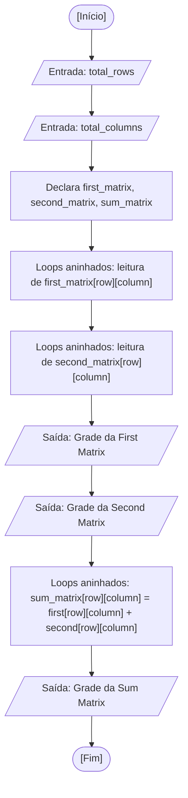

<div align="center">

  🇺🇸 **[English Version](README.md)**
  <br>

  # ⚙️ Soma de Matrizes (`matrix_addition.c`)

</div>

> **Origem:** Aula 08 (Strings, Biblioteca string.h e Matrizes)  
> **Tópico:** Matrizes Bidimensionais (Arrays 2D), Disposição em Linhas e Colunas e Varreduras em Grade

---

## 🎯 Enunciado do Problema

Ler as dimensões (quantidade de linhas e colunas) de duas matrizes de números inteiros de mesmo tamanho, solicitar que o usuário digite os elementos de cada uma, exibir ambas as matrizes formatadas visualmente em grade e calcular a soma elemento a elemento armazenando o resultado em uma terceira matriz. Na minha solução, armazeno os valores em arrays bidimensionais com tamanho definido em tempo de execução e percorro todas as células utilizando loops `for` aninhados indexados por `row` e `column`.

---

## 💻 Código-Fonte

A implementação completa está disponível diretamente em [`matrix_addition.c`](matrix_addition.c).

---

## 📊 Fluxo e Teste de Mesa



Teste de mesa na memória RAM para uma configuração de dimensões $2 \times 2$:

| Passo | Instrução | `row` | `column` | `first_matrix[row][column]` | `second_matrix[row][column]` | `sum_matrix[row][column]` | Saída no Terminal |
| :---: | :--- | :---: | :---: | :---: | :---: | :---: | :--- |
| 1 | Leitura das dimensões | - | - | `total_rows = 2` | `total_columns = 2` | - | Solicita ao usuário |
| 2 | Leitura `first_matrix` | - | - | `[[1, 2], [3, 4]]` | `?` | `?` | Prompts `[row][column]` |
| 3 | Leitura `second_matrix` | - | - | `[[1, 2], [3, 4]]` | `[[5, 6], [7, 8]]` | `?` | Prompts `[row][column]` |
| 4 | Exibição das grades de entrada | - | - | Saída formatada | Saída formatada | `?` | Exibe ambas as matrizes 2x2 |
| 5 | Soma célula `[0][0]` | `0` | `0` | `1` | `5` | `1 + 5 = 6` | - |
| 6 | Soma célula `[0][1]` | `0` | `1` | `2` | `6` | `2 + 6 = 8` | - |
| 7 | Soma célula `[1][0]` | `1` | `0` | `3` | `7` | `3 + 7 = 10` | - |
| 8 | Soma célula `[1][1]` | `1` | `1` | `4` | `8` | `4 + 8 = 12` | - |
| 9 | Exibição da matriz resultante | - | - | - | - | `[[6, 8], [10, 12]]` | Exibe grade da soma |

---

## 🖥️ Saída no Terminal

```text
Enter row size: 2
Enter column size: 3

Enter the values for the first matrix:
Value of [0][0]: 1
Value of [0][1]: 2
Value of [0][2]: 3
Value of [1][0]: 4
Value of [1][1]: 5
Value of [1][2]: 6

Enter the values for the second matrix:
Value of [0][0]: 10
Value of [0][1]: 20
Value of [0][2]: 30
Value of [1][0]: 40
Value of [1][1]: 50
Value of [1][2]: 60

First Matrix:
1 2 3 
4 5 6 

Second Matrix:
10 20 30 
40 50 60 

Sum Matrix:
11 22 33 
44 55 66 
```

---

## 💡 Principais Conceitos Aplicados

- **Matrizes Bidimensionais:** Em C, uma matriz é declarada com dois colchetes: `int matrix[linhas][colunas]`, onde o primeiro índice indica a linha e o segundo representa a coluna.
- **Loops Aninhados para Varredura:** O loop `for` externo comanda a progressão vertical de linhas, enquanto o loop `for` interno percorre horizontalmente cada coluna daquela linha.
- **Disposição na Memória RAM (Row-Major):** Embora modelada conceitualmente como uma tabela bidimensional, a memória física armazena a matriz em sequência linear contígua: todos os elementos da linha 0 antecedem imediatamente os da linha 1.
- **Soma Aritmética Célula a Célula:** Duas matrizes de mesma ordem somam suas coordenadas homólogas: $\text{soma}[row][column] = \text{primeira}[row][column] + \text{segunda}[row][column]$.

---

## 🚀 Como Executar

```bash
# Compilar e executar com GCC
mkdir -p dist && gcc -Wall -O2 src/11-matrix-addition/matrix_addition.c -o dist/matrix_addition && ./dist/matrix_addition

# Ou compilar e executar com Clang (padrão no macOS)
mkdir -p dist && clang -Wall -O2 src/11-matrix-addition/matrix_addition.c -o dist/matrix_addition && ./dist/matrix_addition
```
