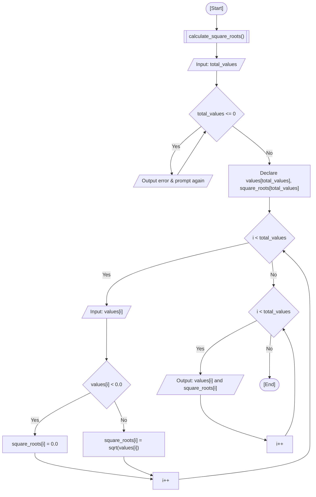

<div align="center">

  🇧🇷 **[Versão em Português](README.pt-BR.md)**
  <br>

  # ⚙️ Square Root Calculator (`square_root_calculator.c`)

</div>

> **Origin:** Class 10 (Functions, Modular Programming & `<math.h>`)  
> **Topic:** Procedural Modularization, Math Library (`-lm`), and Parallel Array Retention

---

## 🎯 Problem Statement

Calculate the square roots of a user-defined series of real numbers using modular functions and the standard C mathematics library (`<math.h>`). In this exercise, I read the desired number of values, prompt the user for each floating-point entry, compute the square root via `sqrt()`, and output the original values alongside their corresponding square roots in a consolidated summary list.

### 🏛️ Classroom Scope vs. Autoral / External Approach

- **Fatec Course Scope:** The classroom prompt focused on modularizing C programs into standalone functions (`void calculateSquareRoots()`) and using standard `<math.h>` mathematical functions (`sqrt()`, `pow()`, `ceil()`, `floor()`). In class, the baseline student example processed inputs on the fly within a single loop without retaining them in memory.
- **My Autoral Extension:** Instead of computing and discarding values immediately, I chose to save them into two parallel arrays (`values[]` and `square_roots[]`), validating user input (re-prompting on non-positive counts, and setting square root to 0.0 for negative numbers). This allows the program to display an organized table of all results after data entry is complete.

---

## 💻 Source Code

The full implementation is available directly in [`square_root_calculator.c`](square_root_calculator.c).

---

## 📊 Algorithmic Flow & Trace



RAM memory trace for inputs `total_values = 3`, `values = [16.0, 25.0, 9.0]`:

| Step | Instruction | `i` | `total_values` | `values[i]` | `square_roots[i]` | Condition Evaluated | Terminal Output |
| :---: | :--- | :---: | :---: | :---: | :---: | :---: | :--- |
| 1 | Function entry | `0` | `0` | `?` | `?` | - | Prompt user for count |
| 2 | Read `total_values` | `0` | `3` | `?` | `?` | `total_values <= 0` -> False | - |
| 3 | Read `values[0]` | `0` | `3` | `16.00` | `?` | `16.00 < 0.0` -> False | - |
| 4 | Compute `sqrt(16.0)` | `0` | `3` | `16.00` | `4.00` | - | - |
| 5 | Read `values[1]` | `1` | `3` | `25.00` | `?` | `25.00 < 0.0` -> False | - |
| 6 | Compute `sqrt(25.0)` | `1` | `3` | `25.00` | `5.00` | - | - |
| 7 | Read `values[2]` | `2` | `3` | `9.00` | `?` | `9.00 < 0.0` -> False | - |
| 8 | Compute `sqrt(9.0)` | `2` | `3` | `9.00` | `3.00` | - | - |
| 9 | Batch report output | `0..2` | `3` | `[16, 25, 9]` | `[4, 5, 3]` | `i < 3` -> Loop ends | Consolidated list |

---

## 🖥️ Terminal Output

```text
How many values do you want to add? 3

Please, insert the values:
Value 1: 16
Value 2: 25
Value 3: 9

--- Results ---
Square root of 16.00 is 4.00
Square root of 25.00 is 5.00
Square root of 9.00 is 3.00
```

---

## 💡 Key Concepts Applied

- **Modular Subroutines:** Decoupling algorithm logic into a specialized procedure (`calculate_square_roots()`) adhering to single responsibility principles.
- **Mathematical Library (`<math.h>`):** Leveraging `sqrt()` for standard IEEE 754 floating-point square root computations.
- **Linker Flag Requirement (`-lm`):** On GCC and Clang in Linux environments, linking against the shared math runtime library (`libm.so`) requires passing the `-lm` argument during compilation.
- **Array Retention vs. Ephemeral I/O:** Storing input values in memory arrays ensures that input collection remains isolated from report generation.

---

## 🚀 How to Run

### Standalone Compilation

```bash
mkdir -p dist && clang -Wall -O2 src/12-square-root-calculator/square_root_calculator.c -o dist/square_root_calculator -lm && ./dist/square_root_calculator
```

### Consolidated Menu Execution

```bash
mkdir -p dist && clang -Wall -O2 src/00-consolidated-menu/consolidated_menu.c -o dist/consolidated_menu -lm && ./dist/consolidated_menu
```
