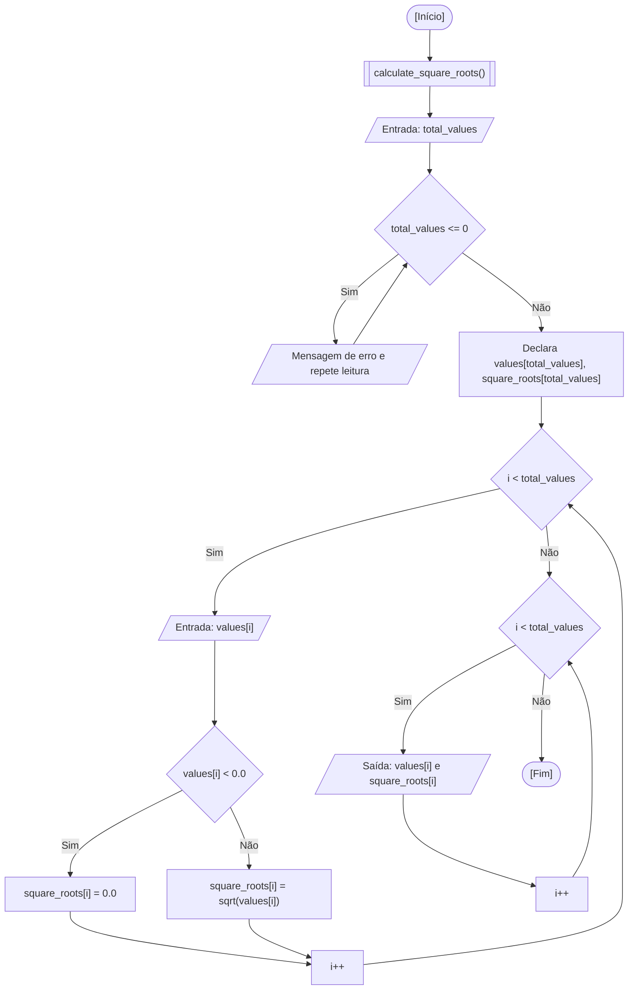

<div align="center">

  🇺🇸 **[English Version](README.md)**
  <br>

  # ⚙️ Calculadora de Raiz Quadrada (`square_root_calculator.c`)

</div>

---

## 🎯 Enunciado do Problema

Calcular as raízes quadradas de uma série de números reais informada pelo usuário, utilizando funções modulares e a biblioteca matemática padrão da linguagem C (`<math.h>`). Neste exercício, leio a quantidade desejada de valores, solicito cada entrada em ponto flutuante, calculo a raiz quadrada através de `sqrt()` e apresento os números originais lado a lado com suas raízes correspondentes em uma lista consolidada.

### 🏛️ Escopo de Aula vs. Abordagem Autoral / Externa

- **Escopo do Curso na Fatec:** O objetivo proposto em sala concentrou-se na modularização de programas em funções (`void calculateSquareRoots()`) e no uso das funções matemáticas de `<math.h>` (`sqrt()`, `pow()`, `ceil()`, `floor()`). A demonstração de base feita em aula processava cada valor e imprimia a saída imediatamente em um único loop, sem reter os dados na memória.
- **Minha Extensão Autoral:** Em vez de calcular e descartar os dados instantaneamente, optei por alocar dois vetores paralelos (`values[]` e `square_roots[]`), validando as entradas de forma defensiva (solicitando nova digitação caso a quantidade fosse menor ou igual a zero e tratando números negativos para os quais $\sqrt{x} \notin \mathbb{R}$). Isso permite ao programa exibir um relatório tabular organizado de todo o conjunto de dados após o término da digitação.

---

## 💻 Código-Fonte

A implementação completa está disponível diretamente em [`square_root_calculator.c`](square_root_calculator.c).

---

## 📊 Fluxo e Teste de Mesa



Teste de mesa na memória RAM para as entradas `total_values = 3`, `values = [16.0, 25.0, 9.0]`:

| Passo | Instrução | `i` | `total_values` | `values[i]` | `square_roots[i]` | Condição Avaliada | Saída no Terminal |
| :---: | :--- | :---: | :---: | :---: | :---: | :---: | :--- |
| 1 | Entrada na função | `0` | `0` | `?` | `?` | - | Solicita quantidade |
| 2 | Leitura de `total_values` | `0` | `3` | `?` | `?` | `total_values <= 0` -> Falso | - |
| 3 | Leitura de `values[0]` | `0` | `3` | `16.00` | `?` | `16.00 < 0.0` -> Falso | - |
| 4 | Cálculo de `sqrt(16.0)` | `0` | `3` | `16.00` | `4.00` | - | - |
| 5 | Leitura de `values[1]` | `1` | `3` | `25.00` | `?` | `25.00 < 0.0` -> Falso | - |
| 6 | Cálculo de `sqrt(25.0)` | `1` | `3` | `25.00` | `5.00` | - | - |
| 7 | Leitura de `values[2]` | `2` | `3` | `9.00` | `?` | `9.00 < 0.0` -> Falso | - |
| 8 | Cálculo de `sqrt(9.0)` | `2` | `3` | `9.00` | `3.00` | - | - |
| 9 | Impressão do relatório | `0..2` | `3` | `[16, 25, 9]` | `[4, 5, 3]` | `i < 3` -> Encerra repetição | Lista consolidada |

---

## 🖥️ Saída no Terminal

```text
How many values do you want to add? 3

Please, insert the values:
Value 1: 16
Value 2: 25
Value 3: 9

--- Results ---
Square root of 16.00 is 4.00
Square root of 25.00 is 5.00
Square root of 9.00 is 3.00
```

---

## 💡 Principais Conceitos Aplicados

- **Sub-rotinas Modulares:** Decomposição da lógica algorítmica em um procedimento dedicado (`calculate_square_roots()`), respeitando o princípio de responsabilidade única.
- **Biblioteca Matemática (`<math.h>`):** Aplicação de `sqrt()` para raízes quadradas em ponto flutuante conforme o padrão IEEE 754.
- **Flag de Ligação (`-lm`):** Em compiladores GCC e Clang no Linux, a vinculação dos símbolos matemáticos da biblioteca compartilhada `libm.so` exige passar explicitamente a flag `-lm` no comando do terminal.
- **Retenção em Vetores vs. Impressão Efêmera:** O armazenamento em arrays isola a etapa de coleta de dados da etapa de geração de relatórios.

---

## 🚀 Como Executar

### Compilação Isolada

```bash
mkdir -p dist && clang -Wall -O2 src/12-square-root-calculator/square_root_calculator.c -o dist/square_root_calculator -lm && ./dist/square_root_calculator
```

### Execução pelo Menu Consolidado

```bash
mkdir -p dist && clang -Wall -O2 src/00-consolidated-menu/consolidated_menu.c -o dist/consolidated_menu -lm && ./dist/consolidated_menu
```
