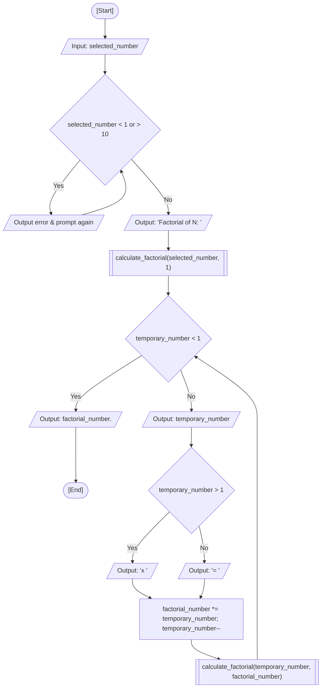

<div align="center">

  🇧🇷 **[Versão em Português](README.pt-BR.md)**
  <br>

  # ⚙️ Recursive Factorial Calculator (`recursive_factorial.c`)

</div>

---

## 🎯 Problem Statement

Compute the factorial of an integer $N$ ($1 \le N \le 10$) using recursive function calls instead of classical iteration loops. In this exercise, I validate the user input defensibly, initiate a tail-recursive function, and output each step of the arithmetic expansion ($N \times (N-1) \times \dots \times 1 = \text{result}$) as the execution progresses through the Call Stack.

### 🏛️ Classroom Scope vs. Autoral / CS50x Exploration

- **Fatec Course Scope:** The classroom prompt was assigned as homework to solve the factorial problem using recursion rather than the iterative loops (`while`, `do-while`, `for`) introduced in previous weeks. The core expectation was establishing a proper base case ($N < 1$) and invoking the function recursively to accumulate the product.
- **My CS50x-Inspired Exploration:** During my initial homework drafting (preserved in my notes and legacy drafts), I challenged myself to implement an advanced variant inspired by CS50x concepts before standardizing on the canonical recursive solution:
  - Practicing explicit Heap memory management via `malloc()` and `free()` to handle multiple factorial requests without relying on Variable Length Arrays (VLAs).
  - Defensive `NULL` pointer checks to handle memory exhaustion.
  - Passing pointers (`int *factorial_number`) and dereferencing (`*factorial_number`) to practice simulated pass-by-reference.
- **Canonical Coursework Submission:** For the final repository module, I selected the elegant recursive accumulator pattern that prints each factor during stack traversal and terminates with the final result at the base case.

---

## 💻 Source Code

The full implementation is available directly in [`recursive_factorial.c`](recursive_factorial.c).

---

## 📊 Algorithmic Flow & Trace



RAM memory trace for input `selected_number = 4`:

| Step / Call | `temporary_number` | `factorial_number` | Condition Evaluated | Stack Action | Terminal Output |
| :---: | :---: | :---: | :---: | :--- | :--- |
| Initial | `4` | `1` | `selected_number` in `1..10` | Caller `main` pushes frame | `"Factorial of 4: "` |
| Call 1 | `4` | `1` | `4 < 1` -> False | Push `calc_fact(4, 1)` | `"4 x "` |
| Call 2 | `3` | `4` | `3 < 1` -> False | Push `calc_fact(3, 4)` | `"3 x "` |
| Call 3 | `2` | `12` | `2 < 1` -> False | Push `calc_fact(2, 12)` | `"2 x "` |
| Call 4 | `1` | `24` | `1 < 1` -> False | Push `calc_fact(1, 24)` | `"1 = "` |
| Call 5 (Base) | `0` | `24` | `0 < 1` -> True (Base Case) | Reached base case, pop frames | `"24.\n"` |

---

## 🖥️ Terminal Output

```text
Enter a number between 1 and 10 to calculate its factorial: 5
Factorial of 5: 5 x 4 x 3 x 2 x 1 = 120.
```

```text
Enter a number between 1 and 10 to calculate its factorial: 1
Factorial of 1: 1 = 1.
```

---

## 💡 Key Concepts Applied

- **Base Case Formulation:** Establishing an explicit guard condition (`temporary_number < 1`) that terminates the chain of auto-invocations and avoids stack overflow.
- **Call Stack Frame Lifecycle:** Passing the running product as an accumulator argument so state is propagated forward across stack frames.
- **Input Bounding:** Restricting inputs to $N \le 10$ to prevent 32-bit signed integer overflow (since $13!$ exceeds `INT_MAX`).
- **CS50x Memory Parallels:** Understanding that while recursion utilizes stack frames, heap allocation (`malloc`/`free`) provides complementary dynamic memory management for unbounded data structures.

---

## 🚀 How to Run

### Standalone Compilation

```bash
mkdir -p dist && clang -Wall -O2 src/13-recursive-factorial/recursive_factorial.c -o dist/recursive_factorial && ./dist/recursive_factorial
```

### Consolidated Menu Execution

```bash
mkdir -p dist && clang -Wall -O2 src/00-consolidated-menu/consolidated_menu.c -o dist/consolidated_menu -lm && ./dist/consolidated_menu
```
