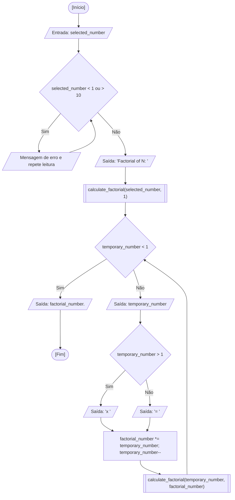

<div align="center">

  🇺🇸 **[English Version](README.md)**
  <br>

  # ⚙️ Calculadora de Fatorial Recursivo (`recursive_factorial.c`)

</div>

---

## 🎯 Enunciado do Problema

Calcular o fatorial de um número inteiro $N$ ($1 \le N \le 10$) utilizando chamadas recursivas de função em vez de repetições iterativas convencionais. Neste exercício, valido defensivamente a entrada do usuário, inicio uma função recursiva acumuladora e apresento cada etapa da expansão aritmética ($N \times (N-1) \times \dots \times 1 = \text{resultado}$) conforme o fluxo avança pelos quadros de ativação da pilha de execução (*Call Stack*).

### 🏛️ Escopo de Aula vs. Exploração Autoral / CS50x

- **Escopo do Curso na Fatec:** A proposta foi atribuída como tarefa extraclasse para solucionar o cálculo de fatorial através de recursividade, em contraponto às repetições iterativas (`while`, `do-while`, `for`) vistas nas semanas anteriores. A expectativa era definir um caso base consistente ($N < 1$) e invocar a própria função para acumular o produto.
- **Minha Exploração Inspirada no CS50x:** Durante os rascunhos iniciais da tarefa (preservados nas minhas notas e na pasta de rascunhos de legado), resolvi ir além para exercitar conceitos que aprendi no CS50x antes de fechar a versão canônica:
  - Prática de gerenciamento manual de memória na Heap com `malloc()` e `free()` para processar múltiplos fatoriais em lote sem depender de vetores de tamanho variável (VLAs).
  - Verificação defensiva de ponteiro nulo (`NULL`) em caso de esgotamento de memória.
  - Passagem explícita de ponteiros (`int *factorial_number`) e uso do operador de desreferenciação (`*factorial_number`) para simular passagem por referência.
- **Versão Canônica Submetida:** Para o repositório oficial, adotei a implementação recursiva com acumulador, que imprime cada fator durante o empilhamento e encerra com o resultado formatado ao atingir o caso base.

---

## 💻 Código-Fonte

A implementação completa está disponível diretamente em [`recursive_factorial.c`](recursive_factorial.c).

---

## 📊 Fluxo e Teste de Mesa



Teste de mesa na memória RAM para a entrada `selected_number = 4`:

| Passo / Chamada | `temporary_number` | `factorial_number` | Condição Avaliada | Ação na Pilha | Saída no Terminal |
| :---: | :---: | :---: | :---: | :--- | :--- |
| Inicial | `4` | `1` | `selected_number` em `1..10` | Função `main` empilha quadro | `"Factorial of 4: "` |
| Chamada 1 | `4` | `1` | `4 < 1` -> Falso | Empilha `calc_fact(4, 1)` | `"4 x "` |
| Chamada 2 | `3` | `4` | `3 < 1` -> Falso | Empilha `calc_fact(3, 4)` | `"3 x "` |
| Chamada 3 | `2` | `12` | `2 < 1` -> Falso | Empilha `calc_fact(2, 12)` | `"2 x "` |
| Chamada 4 | `1` | `24` | `1 < 1` -> Falso | Empilha `calc_fact(1, 24)` | `"1 = "` |
| Chamada 5 (Base) | `0` | `24` | `0 < 1` -> Verdadeiro (Caso Base) | Atinge caso base, desempilha | `"24.\n"` |

---

## 🖥️ Saída no Terminal

```text
Enter a number between 1 and 10 to calculate its factorial: 5
Factorial of 5: 5 x 4 x 3 x 2 x 1 = 120.
```

```text
Enter a number between 1 and 10 to calculate its factorial: 1
Factorial of 1: 1 = 1.
```

---

## 💡 Principais Conceitos Aplicados

- **Formulação do Caso Base:** Estabelece uma condição explícita de guarda (`temporary_number < 1`) que interrompe a cadeia de auto-invocações, prevenindo o estouro da pilha de execução (*stack overflow*).
- **Ciclo de Vida de Quadros na Pilha:** Propaga o produto acumulado através dos argumentos formais da função recursiva.
- **Limitação de Entrada:** Restringe os valores aceitos a $N \le 10$ para evitar estouro de representação em inteiros de 32 bits com sinal ($13!$ excede o limite de `INT_MAX`).
- **Paralelo de Memória com CS50x:** Compreensão de que, enquanto a recursão opera na pilha (*Stack*), a alocação dinâmica (`malloc`/`free`) opera na Heap para estruturas de tamanho não predeterminado.

---

## 🚀 Como Executar

### Compilação Isolada

```bash
mkdir -p dist && clang -Wall -O2 src/13-recursive-factorial/recursive_factorial.c -o dist/recursive_factorial && ./dist/recursive_factorial
```

### Execução pelo Menu Consolidado

```bash
mkdir -p dist && clang -Wall -O2 src/00-consolidated-menu/consolidated_menu.c -o dist/consolidated_menu -lm && ./dist/consolidated_menu
```
