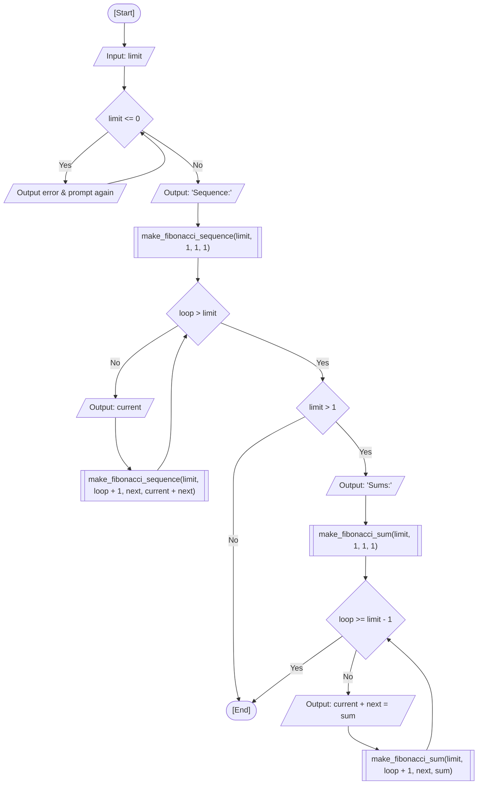

<div align="center">

  🇧🇷 **[Versão em Português](README.pt-BR.md)**
  <br>

  # ⚙️ Recursive Fibonacci Sequence (`recursive_fibonacci.c`)

</div>

> **Origin:** Class 11 (Recursion & Call Stack)  
> **Topic:** Recursive Recurrence Relations & Pairwise Addition Decomposition  
> **Lineage:** Recursive evolution from comparative iterative implementations in [Classes 06 & 08: Fibonacci Sequence](../07-fibonacci-sequence)

---

## 🎯 Problem Statement

Generate the terms of the Fibonacci sequence ($F_n = F_{n-1} + F_{n-2}$) and visualize each step-by-step arithmetic addition using recursive functions. In this exercise, I enforce defensive validation to ensure a strictly positive term limit ($N > 0$), invoke a recursive printer for the sequence terms, and trigger a second recursive routine that breaks down the pairwise addition steps for all terms when $N > 1$.

### 🏛️ Classroom Scope vs. Autoral / External Approach

- **Fatec Course Scope:** Assigned as a companion homework exercise alongside recursive factorial to solidify recursive function thinking, base cases, and parameter passing.
- **My Autoral Extension:** Rather than limiting the solution to a standard single recurrence, I structured the implementation into two modular recursive subroutines:
  - `make_fibonacci_sequence()`: advances a tail-recursive counter to output each sequence term in order.
  - `make_fibonacci_sum()`: recursively models the pairwise arithmetic transitions ($1 + 1 = 2, 1 + 2 = 3, \dots$), clearly detailing the mechanics of the recurrence relation.
  - Input validation: wrapped in a `while (limit <= 0)` loop to reject non-positive counts.

---

## 💻 Source Code

The full implementation is available directly in [`recursive_fibonacci.c`](recursive_fibonacci.c).

---

## 📊 Algorithmic Flow & Trace



RAM memory trace for input `limit = 4`:

| Routine | `loop` | `limit` | `current` | `next` | `sum` | Condition Evaluated | Terminal Output |
| :---: | :---: | :---: | :---: | :---: | :---: | :---: | :--- |
| `main` | - | `4` | - | - | - | `limit <= 0` -> False | `"Sequence:\n"` |
| `make_seq` | `1` | `4` | `1` | `1` | `2` | `1 > 4` -> False | `"1 "` |
| `make_seq` | `2` | `4` | `1` | `2` | `3` | `2 > 4` -> False | `"1 "` |
| `make_seq` | `3` | `4` | `2` | `3` | `5` | `3 > 4` -> False | `"2 "` |
| `make_seq` | `4` | `4` | `3` | `5` | `8` | `4 > 4` -> False | `"3 "` |
| `make_seq` | `5` | `4` | `5` | `8` | `13` | `5 > 4` -> True (Base) | Sequence complete |
| `make_sum` | `1` | `4` | `1` | `1` | `2` | `1 >= 3` -> False | `"1 + 1 = 2\n"` |
| `make_sum` | `2` | `4` | `1` | `2` | `3` | `2 >= 3` -> False | `"1 + 2 = 3\n"` |
| `make_sum` | `3` | `4` | `2` | `3` | `5` | `3 >= 3` -> True (Base) | Sums complete |

---

## 🖥️ Terminal Output

```text
Insert a limit number greater than 0 for the fibonacci sequence: 6

Sequence:
1 1 2 3 5 8 

Sums:
1 + 1 = 2
1 + 2 = 3
2 + 3 = 5
3 + 5 = 8
```

```text
Insert a limit number greater than 0 for the fibonacci sequence: 1

Sequence:
1 
```

---

## 💡 Key Concepts Applied

- **Multi-Argument Tail Recursion:** Passing current and next state variables forward (`current`, `next`, `current + next`) across successive stack frames to eliminate redundant recalculation.
- **Linear Space Complexity:** Unlike naive recursive Fibonacci (`fib(n-1) + fib(n-2)`) which produces an exponential call tree $\mathcal{O}(2^n)$, forward state propagation runs in strict linear $\mathcal{O}(n)$ time and space.
- **Selective Subroutine Invocation:** Conditionally executing arithmetic decomposition (`make_fibonacci_sum`) only when sufficient terms exist ($N > 1$).

---

## 🚀 How to Run

### Standalone Compilation

```bash
mkdir -p dist && clang -Wall -O2 src/14-recursive-fibonacci/recursive_fibonacci.c -o dist/recursive_fibonacci && ./dist/recursive_fibonacci
```

### Consolidated Menu Execution

```bash
mkdir -p dist && clang -Wall -O2 src/00-consolidated-menu/consolidated_menu.c -o dist/consolidated_menu -lm && ./dist/consolidated_menu
```
