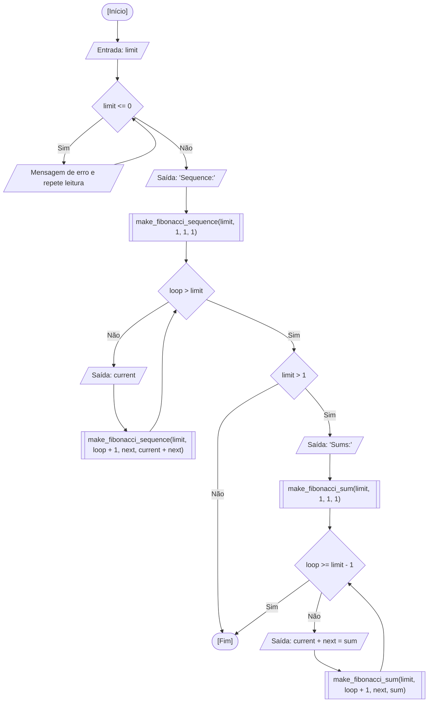

<div align="center">

  🇺🇸 **[English Version](README.md)**
  <br>

  # ⚙️ Sequência de Fibonacci Recursiva (`recursive_fibonacci.c`)

</div>

> **Origem:** Aula 11 (Recursividade e Pilha de Execução)  
> **Tópico:** Relações de Recorrência Recursivas e Decomposição de Adições  
> **Continuidade:** Evolução recursiva a partir das implementações iterativas em [Aulas 06 e 08: Sequência de Fibonacci](../07-fibonacci-sequence)

---

## 🎯 Enunciado do Problema

Gerar os termos da sequência de Fibonacci ($F_n = F_{n-1} + F_{n-2}$) e detalhar cada adição aritmética passo a passo utilizando funções recursivas. Neste exercício, aplico validação defensiva para garantir um limite estritamente positivo de termos ($N > 0$), executo uma rotina recursiva para imprimir a sequência e disparo um segundo procedimento recursivo para decompor as somas parciais sempre que $N > 1$.

### 🏛️ Escopo de Aula vs. Abordagem Autoral / Externa

- **Escopo do Curso na Fatec:** Atribuído como tarefa extraclasse em conjunto com o fatorial recursivo para consolidar o raciocínio recursivo, a formulação de casos base e a passagem de argumentos.
- **Minha Extensão Autoral:** Em vez de restringir a solução a uma única chamada de recorrência simples, estruturei a implementação em duas sub-rotinas recursivas complementares:
  - `make_fibonacci_sequence()`: avança um contador com recursão em cauda para exibir cada termo ordenadamente.
  - `make_fibonacci_sum()`: modela recursivamente as transições aritméticas ($1 + 1 = 2, 1 + 2 = 3, \dots$), detalhando a mecânica da relação de recorrência.
  - Validação defensiva com `while (limit <= 0)` para rejeitar quantidades não positivas.

---

## 💻 Código-Fonte

A implementação completa está disponível diretamente em [`recursive_fibonacci.c`](recursive_fibonacci.c).

---

## 📊 Fluxo e Teste de Mesa



Teste de mesa na memória RAM para a entrada `limit = 4`:

| Rotina | `loop` | `limit` | `current` | `next` | `sum` | Condição Avaliada | Saída no Terminal |
| :---: | :---: | :---: | :---: | :---: | :---: | :---: | :--- |
| `main` | - | `4` | - | - | - | `limit <= 0` -> Falso | `"Sequence:\n"` |
| `make_seq` | `1` | `4` | `1` | `1` | `2` | `1 > 4` -> Falso | `"1 "` |
| `make_seq` | `2` | `4` | `1` | `2` | `3` | `2 > 4` -> Falso | `"1 "` |
| `make_seq` | `3` | `4` | `2` | `3` | `5` | `3 > 4` -> Falso | `"2 "` |
| `make_seq` | `4` | `4` | `3` | `5` | `8` | `4 > 4` -> Falso | `"3 "` |
| `make_seq` | `5` | `4` | `5` | `8` | `13` | `5 > 4` -> Verdadeiro (Caso Base) | Sequência concluída |
| `make_sum` | `1` | `4` | `1` | `1` | `2` | `1 >= 3` -> Falso | `"1 + 1 = 2\n"` |
| `make_sum` | `2` | `4` | `1` | `2` | `3` | `2 >= 3` -> Falso | `"1 + 2 = 3\n"` |
| `make_sum` | `3` | `4` | `2` | `3` | `5` | `3 >= 3` -> Verdadeiro (Caso Base) | Somas concluídas |

---

## 🖥️ Saída no Terminal

```text
Insert a limit number greater than 0 for the fibonacci sequence: 6

Sequence:
1 1 2 3 5 8 

Sums:
1 + 1 = 2
1 + 2 = 3
2 + 3 = 5
3 + 5 = 8
```

```text
Insert a limit number greater than 0 for the fibonacci sequence: 1

Sequence:
1 
```

---

## 💡 Principais Conceitos Aplicados

- **Recursão em Cauda com Múltiplos Argumentos:** Propagação de variáveis de estado (`current`, `next`, `current + next`) através de sucessivos quadros de pilha, eliminando recálculos redundantes.
- **Complexidade Espacial Linear:** Diferente do modelo ingênuo de Fibonacci com árvore binária (`fib(n-1) + fib(n-2)`), que atinge complexidade exponencial $\mathcal{O}(2^n)$, a passagem contínua de estado garante tempo e espaço lineares $\mathcal{O}(n)$.
- **Invocação Condicional:** Disparo da rotina de decomposição aritmética (`make_fibonacci_sum`) exclusivamente quando há termos suficientes para adição ($N > 1$).

---

## 🚀 Como Executar

### Compilação Isolada

```bash
mkdir -p dist && clang -Wall -O2 src/14-recursive-fibonacci/recursive_fibonacci.c -o dist/recursive_fibonacci && ./dist/recursive_fibonacci
```

### Execução pelo Menu Consolidado

```bash
mkdir -p dist && clang -Wall -O2 src/00-consolidated-menu/consolidated_menu.c -o dist/consolidated_menu -lm && ./dist/consolidated_menu
```
