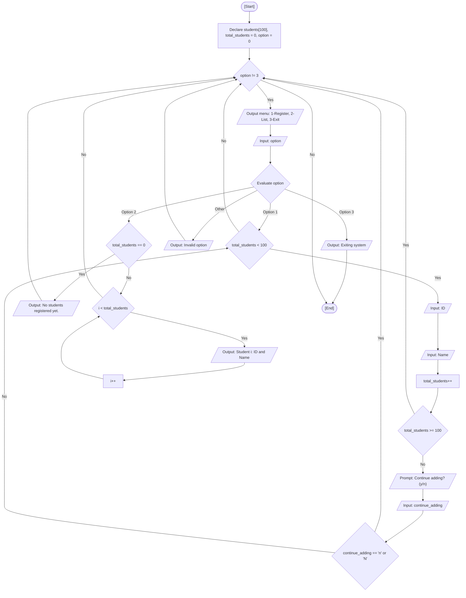

<div align="center">

  🇧🇷 **[Versão em Português](README.pt-BR.md)**
  <br>

  # ⚙️ Academic Management System (`academic_management_system.c`)

</div>

> **Origin:** Class 12 (User-Defined Types: struct & typedef)  
> **Topic:** Composite Data Types (`struct`), Type Aliasing (`typedef`), and Array of Records

---

## 🎯 Problem Statement

Manage student records using user-defined composite data structures (`struct`) and type aliases (`typedef`) instead of separate parallel arrays. In this exercise, I build an interactive console program where the user can register student IDs and names into an array of structures, view the list of registered students, or exit.

### 🏛️ Classroom Scope vs. Autoral / External Approach

- **Fatec Course Scope:** The lesson started by showing why parallel arrays (`ids[10]` and `names[10]`) can easily become disorganized. The professor then introduced `struct STUDENT { int id; char name[50]; };` to keep related data together in one record, and `typedef struct STUDENT STUDENT;` as a convenient alias so we don't need to write `struct STUDENT` every time.
- **My Autoral Extension:** In the classroom example, the program returned to the main menu after each registered student, with a limit of 10 students. In my version:
  - Added a continuous registration loop asking `Do you want to continue adding students? (y/n): `, allowing the user to enroll multiple students in a row.
  - Increased array capacity to `#define MAX_STUDENTS 100` with boundary checks.
  - Added an empty state check (`No students registered yet.`) before listing students.
  - Cleared the keyboard buffer with `scanf(" %c", &continue_adding)`.

---

## 💻 Source Code

The full implementation is available directly in [`academic_management_system.c`](academic_management_system.c).

---

## 📊 Algorithmic Flow & Trace



RAM memory trace for registering one student (`ID = 101, Name = "Lucas"`):

| Step | Instruction | `option` | `total_students` | `students[0].id` | `students[0].name` | Condition Evaluated | Terminal Output |
| :---: | :--- | :---: | :---: | :---: | :---: | :---: | :--- |
| 1 | Initialization | `0` | `0` | `?` | `?` | - | Display menu |
| 2 | Read `option` | `1` | `0` | `?` | `?` | `option == 1` -> True | - |
| 3 | Read `students[0].id` | `1` | `0` | `101` | `?` | - | Prompt `"ID: "` |
| 4 | Read `students[0].name`| `1` | `0` | `101` | `"Lucas\0"` | - | Prompt `"Name: "` |
| 5 | Increment counter | `1` | `1` | `101` | `"Lucas\0"` | `total_students >= 100` -> False | - |
| 6 | Ask continuation | `1` | `1` | `101` | `"Lucas\0"` | `continue_adding == 'n'` -> True | `"Returning to menu..."` |
| 7 | Next menu cycle | `2` | `1` | `101` | `"Lucas\0"` | `option == 2` -> True | - |
| 8 | Listing roster | `2` | `1` | `101` | `"Lucas\0"` | `total_students == 0` -> False | `"Student 1: ID = 101 \| Name = Lucas"` |

---

## 🖥️ Terminal Output

```text
================================================================
                   Academic Management System
================================================================
1 - Register students
2 - Show all students
3 - Exit
================================================================

Select an option (1-3): 1

--- Student 1 ---
ID: 101
Name: Lucas
Do you want to continue adding students? (y/n): y

--- Student 2 ---
ID: 102
Name: Alexandre
Do you want to continue adding students? (y/n): n
Returning to the menu...

================================================================
                   Academic Management System
================================================================
1 - Register students
2 - Show all students
3 - Exit
================================================================

Select an option (1-3): 2

================================================================
                        Student List
================================================================
Student 1: ID = 101 | Name = Lucas
Student 2: ID = 102 | Name = Alexandre
================================================================
```

---

## 💡 Key Concepts Applied

- **Heterogeneous Compound Data (`struct`):** Encapsulating multi-typed fields (`int id` and `char name[50]`) within a single logical entity, ensuring memory contiguity and semantic cohesion.
- **Type Aliasing (`typedef`):** Defining `STUDENT` as an alias for `struct STUDENT` to reduce boilerplate across declarations and function signatures.
- **Array of Structures:** Allocating contiguous memory blocks (`STUDENT students[MAX_STUDENTS]`) accessible via standard indexation and member access (`students[i].id`).
- **Interactive Batch Data Entry:** Implementing internal continuation loops to facilitate record creation while defending against buffer pollution with leading-space `scanf`.

---

## 🚀 How to Run

### Standalone Compilation

```bash
mkdir -p dist && clang -Wall -O2 src/15-academic-management-system/academic_management_system.c -o dist/academic_management_system && ./dist/academic_management_system
```

### Consolidated Menu Execution

```bash
mkdir -p dist && clang -Wall -O2 src/00-consolidated-menu/consolidated_menu.c -o dist/consolidated_menu -lm && ./dist/consolidated_menu
```
