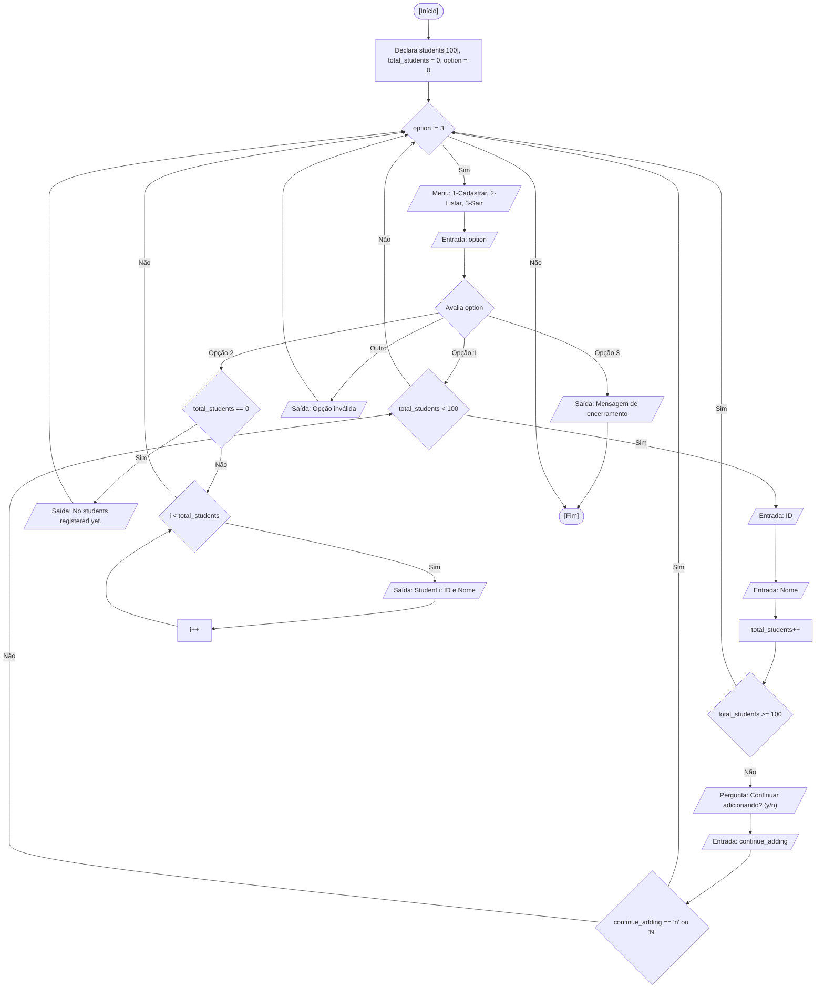

<div align="center">

  🇺🇸 **[English Version](README.md)**
  <br>

  # ⚙️ Sistema de Gerenciamento Acadêmico (`academic_management_system.c`)

</div>

---

## 🎯 Enunciado do Problema

Gerenciar registros acadêmicos de estudantes superando a fragilidade de vetores paralelos através do uso de tipos de dados compostos heterogêneos (`struct`) e definição de pseudônimos de tipos (`typedef`). Neste exercício, disponibilizo um console interativo que permite ao usuário cadastrar números de matrícula e nomes de estudantes em um vetor contíguo de estruturas, listar todos os registros gravados ou encerrar o programa.

### 🏛️ Escopo de Aula vs. Abordagem Autoral / Externa

- **Escopo do Curso na Fatec:** A progressão didática em sala começou demonstrando as deficiências de vetores paralelos desconexos (`int ids[10]` e `char names[10][15]`, que não possuem ligação formal na memória física). Em seguida, o docente introduziu `struct STUDENT { int id; char name[...]; }` para conferir coesão de entidade e `typedef struct STUDENT STUDENT;` para simplificar a sintaxe, mencionando como referência o uso de pseudônimos por Andrew Tanenbaum.
- **Minha Extensão Autoral:** O código-base demonstrado em sala forçava o retorno ao menu principal após o cadastro de cada aluno individual e mantinha um limite rígido de 10 posições. Na minha versão:
  - Desenvolvi uma repetição interna de cadastro contínuo perguntando `Do you want to continue adding students? (y/n): `, permitindo registrar múltiplos alunos em sequência sem retornar ao menu a cada entrada.
  - Ampliei a capacidade máxima para `#define MAX_STUDENTS 100` com verificação de limites.
  - Implementei tratamento de base vazia (`No students registered yet.`) ao listar os alunos, evitando a impressão de memória não inicializada.
  - Tratei defensivamente a limpeza do buffer de entrada do teclado com `scanf(" %c", &continue_adding)`.

---

## 💻 Código-Fonte

A implementação completa está disponível diretamente em [`academic_management_system.c`](academic_management_system.c).

---

## 📊 Fluxo e Teste de Mesa



Teste de mesa na memória RAM para o cadastro de um aluno (`ID = 101, Name = "Lucas"`):

| Passo | Instrução | `option` | `total_students` | `students[0].id` | `students[0].name` | Condição Avaliada | Saída no Terminal |
| :---: | :--- | :---: | :---: | :---: | :---: | :---: | :--- |
| 1 | Inicialização | `0` | `0` | `?` | `?` | - | Exibe menu |
| 2 | Leitura de `option` | `1` | `0` | `?` | `?` | `option == 1` -> Verdadeiro | - |
| 3 | Leitura de `students[0].id` | `1` | `0` | `101` | `?` | - | Solicita `"ID: "` |
| 4 | Leitura de `students[0].name`| `1` | `0` | `101` | `"Lucas\0"` | - | Solicita `"Name: "` |
| 5 | Incremento do contador | `1` | `1` | `101` | `"Lucas\0"` | `total_students >= 100` -> Falso | - |
| 6 | Pergunta de continuidade | `1` | `1` | `101` | `"Lucas\0"` | `continue_adding == 'n'` -> Verdadeiro | `"Returning to menu..."` |
| 7 | Próximo ciclo do menu | `2` | `1` | `101` | `"Lucas\0"` | `option == 2` -> Verdadeiro | - |
| 8 | Listagem dos alunos | `2` | `1` | `101` | `"Lucas\0"` | `total_students == 0` -> Falso | `"Student 1: ID = 101 \| Name = Lucas"` |

---

## 🖥️ Saída no Terminal

```text
================================================================
                   Academic Management System
================================================================
1 - Register students
2 - Show all students
3 - Exit
================================================================

Select an option (1-3): 1

--- Student 1 ---
ID: 101
Name: Lucas
Do you want to continue adding students? (y/n): y

--- Student 2 ---
ID: 102
Name: Alexandre
Do you want to continue adding students? (y/n): n
Returning to the menu...

================================================================
                   Academic Management System
================================================================
1 - Register students
2 - Show all students
3 - Exit
================================================================

Select an option (1-3): 2

================================================================
                        Student List
================================================================
Student 1: ID = 101 | Name = Lucas
Student 2: ID = 102 | Name = Alexandre
================================================================
```

---

## 💡 Principais Conceitos Aplicados

- **Dados Compostos Heterogêneos (`struct`):** Agrupamento de campos de tipos distintos (`int id` e `char name[50]`) dentro de uma entidade lógica única, garantindo integridade de memória e coesão semântica.
- **Definição de Pseudônimos de Tipo (`typedef`):** Criação do alias `STUDENT` para `struct STUDENT`, eliminando a necessidade de repetir a palavra-chave `struct` nas declarações.
- **Vetor de Estruturas:** Alocação de blocos contíguos de memória (`STUDENT students[MAX_STUDENTS]`), acessíveis através de índices convencionais e do operador ponto (`students[i].id`).
- **Entrada Interativa Contínua:** Implementação de loop interno de continuidade para agilizar a inclusão de registros com limpeza defensiva do buffer de teclado.

---

## 🚀 Como Executar

### Compilação Isolada

```bash
mkdir -p dist && clang -Wall -O2 src/15-academic-management-system/academic_management_system.c -o dist/academic_management_system && ./dist/academic_management_system
```

### Execução pelo Menu Consolidado

```bash
mkdir -p dist && clang -Wall -O2 src/00-consolidated-menu/consolidated_menu.c -o dist/consolidated_menu -lm && ./dist/consolidated_menu
```
